Parte 6 - SAVI
==============
Miguel Riem Oliveira <mriem@ua.pt>
2026-2027

# Sumário

- Otimização aplicada a visão por computador
- Correção de brilho e contraste
- _Image mosaicking_ e correção de côr
- Alinhamento geométrico e fotométrico

# Exercícios

## Exercício 1 - Brilho médio e contraste alvo

Considere a imagem **images/marvao/1.png**:

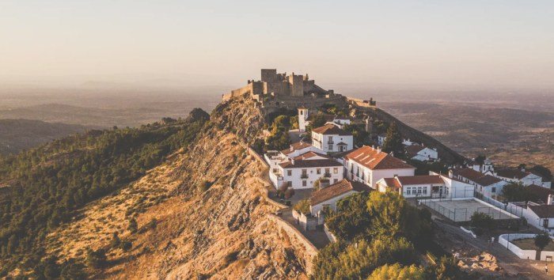

A imagem pode ser alterada aplicando a todos os pixeis um fator de escala $s$ e um _bias_ $b$, da seguinte forma:

$I^{´}(x,y) = s \cdot I(x,y)  + b$

O objetivo é encontrar, por otimização, os parâmetros $s$ e $b$ que deixam a imagem com um brilho médio e um contraste escolhidos: o brilho médio alvo e o contraste alvo.

Use dois tipos de erro:

- **erro de brilho médio**: a diferença entre um brilho médio alvo (por exemplo 80 para uma imagem escura, 200 para uma imagem clara) e a média dos pixeis da imagem;
- **erro de contraste**: a diferença entre um contraste alvo (por exemplo 30 para pouco contraste, 70 para muito contraste) e o contraste da imagem. O contraste é medido pelo desvio padrão dos pixeis da imagem. A imagem original tem brilho médio 140 e contraste 62.

1. Implemente a otimização apenas com o erro de brilho médio. A imagem fica com o brilho médio pretendido? E o contraste? Quantas soluções tem este problema?
2. Acrescente o erro de contraste e corra de novo.
3. Experimente vários brilhos médios e contrastes alvo, por exemplo uma imagem escura, uma imagem clara e uma imagem com pouco contraste.

Só com o erro de brilho médio, brilho médio alvo 80. O brilho médio fica 80, mas o contraste fica em 36, um valor que ninguém escolheu:

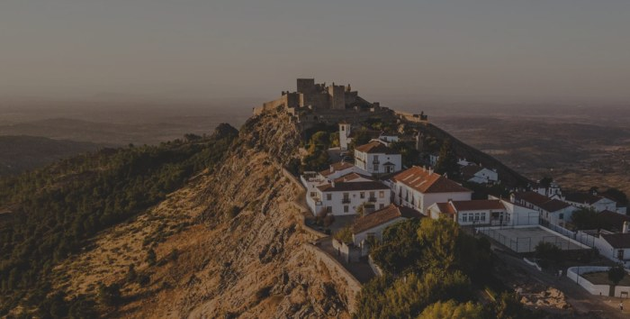

Com os erros de brilho médio e de contraste, brilho médio alvo 80 e contraste alvo 60:

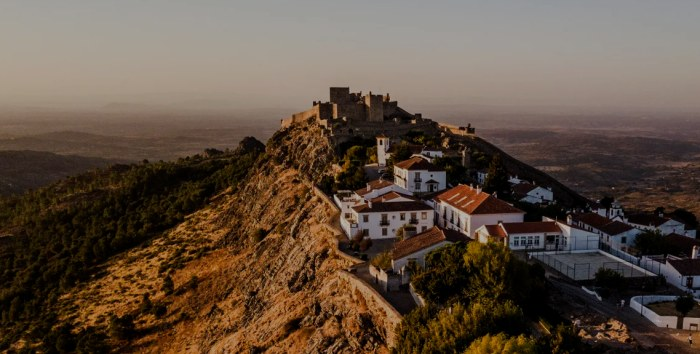

Brilho médio alvo 200 e contraste alvo 60:

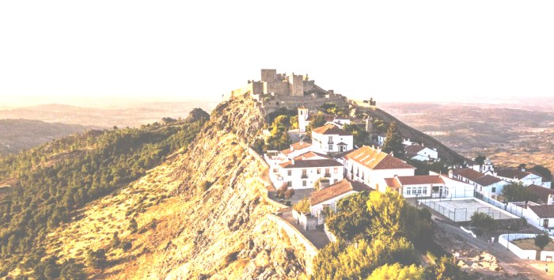

Brilho médio alvo 140 e contraste alvo 30:

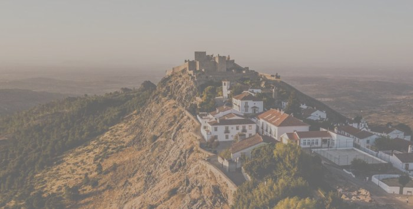

## Exercício 2 - Correção de côr num mosaico

Recupere o último exercício da Parte 04. O objetivo era o de fazer _stitching_ de duas imagens de modo a produzir um mosaico.

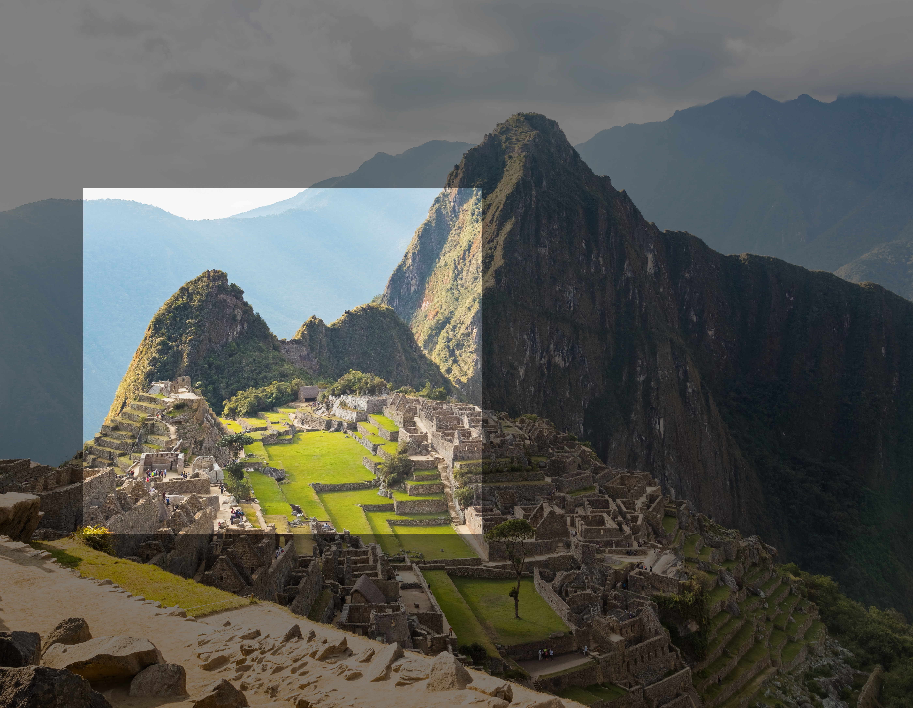

Neste exercício e nos seguintes usam-se as imagens da pasta **images/machu_pichu**. A imagem _train_ (**1.png**, 5598 x 4346 pixeis):

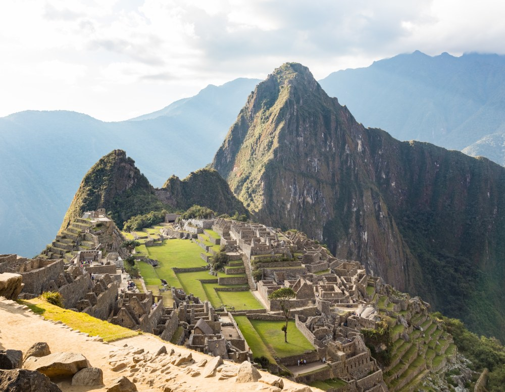

A imagem _query_ (**2.png**, 2442 x 2122 pixeis), mostrada à mesma escala. É um recorte da imagem _train_, com as cores alteradas:

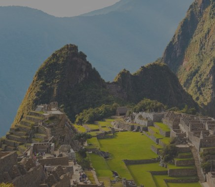

Para não ter de repetir o exercício da Parte 04, use:

- **1.png**, a imagem _train_;
- **query_warped.png**, a imagem _query_ já transformada para o referencial da imagem _train_, com o mesmo tamanho que esta. Os pixeis que não pertencem à imagem _query_ estão a preto.

O mosaico tem um bom alinhamento geométrico, visto que os objetos de ambas as imagens estão perfeitamente alinhados.

No entanto, a côr dos objetos está claramente desalinhada.

Use o modelo do exercício 1 para corrigir a côr das imagens. Desta vez não há um alvo fixo, como o brilho médio alvo e o contraste alvo do exercício 1: o objetivo é tornar as duas imagens o mais similares possível.

A função objetivo deve devolver um **erro de similaridade** por cada pixel da zona de sobreposição: a diferença entre as duas imagens nesse pixel.

1. Corrija as duas imagens ao mesmo tempo, cada uma com os seus parâmetros $s$ e $b$ (4 parâmetros no total). O que acontece? Porquê?
2. Para a otimização não degenerar é preciso uma referência que não possa mudar. Use a imagem _train_ como referência: mantenha-a fixa e corrija apenas a imagem _query_ (2 parâmetros).
3. Experimente devolver um único valor com a média dos erros de similaridade, em vez de um erro por pixel. O que acontece? Porquê?

Resultado do passo 1. As duas imagens ficam iguais, mas completamente pretas:

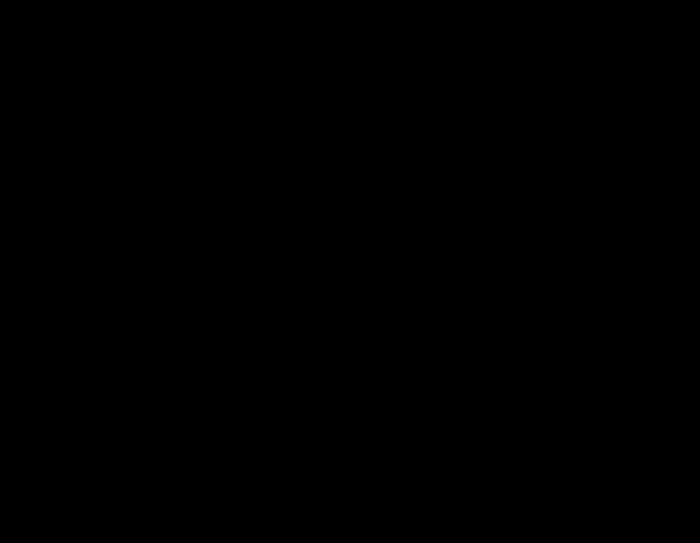

Resultado do passo 2:

## Exercício 3 - Mosaico com brilho médio e contraste alvo

No exercício 2 o objetivo era apenas tornar as imagens semelhantes. Agora pretende-se também escolher o aspeto final do mosaico: um mosaico no qual não sejam visíveis as transições da imagem _train_ para a imagem _query_, mas que seja escuro, ou claro.

Junte os exercícios 1 e 2. As duas imagens são corrigidas, cada uma com os seus parâmetros $s$ e $b$ (4 parâmetros no total), e a função objetivo devolve, calculados na zona de sobreposição, os **erros de similaridade** do exercício 2 (um por pixel) e os **erros de brilho médio** e **de contraste** do exercício 1 (um por imagem). Como contraste alvo use o contraste da imagem _train_ original.

No exercício 2 a referência era a imagem _train_, mantida fixa. Aqui a referência passa a ser o brilho médio alvo e o contraste alvo, como no exercício 1. Por isso as duas imagens podem ser corrigidas ao mesmo tempo sem que a otimização degenere, como acontecia no passo 1 do exercício 2.

Há milhares de erros de similaridade e apenas quatro erros de brilho médio e de contraste. Que influência têm estes últimos na otimização? Como é que lhes pode dar o mesmo peso? (Lembre-se que o _least squares_ minimiza a soma dos quadrados dos erros.)

Brilho médio alvo 80:

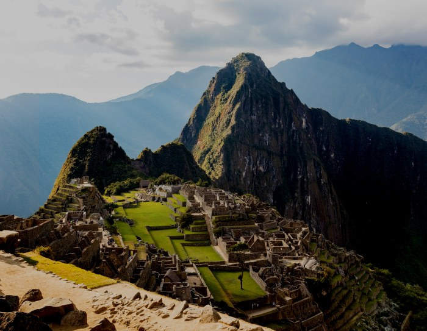

Brilho médio alvo 200:

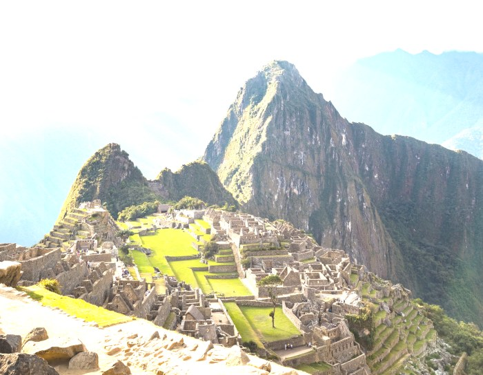

## Exercício 4 - Alinhamento geométrico

Nos exercícios 2 e 3 a imagem _query_ já vinha colocada no sítio certo dentro da imagem _train_. Agora o objetivo é descobrir esse sítio por otimização. Use as imagens **1.png** (_train_) e **2.png** (_query_).

Como a imagem _query_ está completamente dentro da imagem _train_, basta considerar uma translação: o pixel $(x, y)$ da imagem _query_ corresponde ao pixel $(x + \Delta x, y + \Delta y)$ da imagem _train_.

1. Detete _features_ SIFT nas duas imagens e faça a associação entre elas, como na Parte 04. Mostre os _key points_ encontrados em cada imagem e as associações.
2. Defina uma função objetivo que receba os parâmetros $\Delta x$ e $\Delta y$ e devolva, para cada par de pontos, o erro em $x$ e em $y$ entre o ponto da _query_ deslocado e o ponto correspondente da _train_.
3. Use o _least squares_ do scipy para estimar $\Delta x$ e $\Delta y$. Os valores possíveis estão limitados pelos tamanhos das imagens; use o argumento `bounds`.
4. Em cada iteração mostre o mosaico, de modo a ver a imagem a deslocar-se.
5. Compare o resultado com a média das diferenças entre os pares de pontos. Porque é que são iguais?

_Key points_ encontrados na imagem _train_ e na imagem _query_:

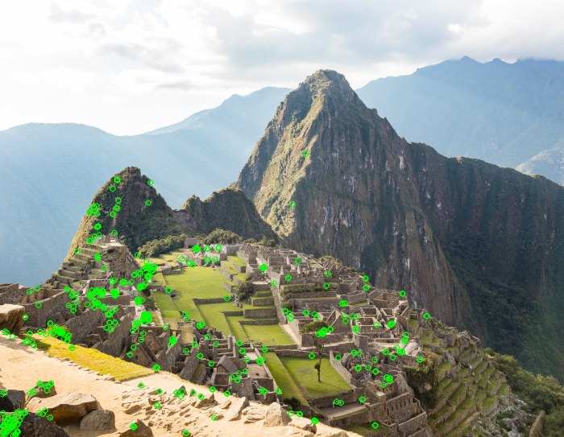

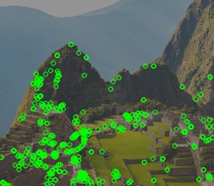

Associações entre as duas imagens:

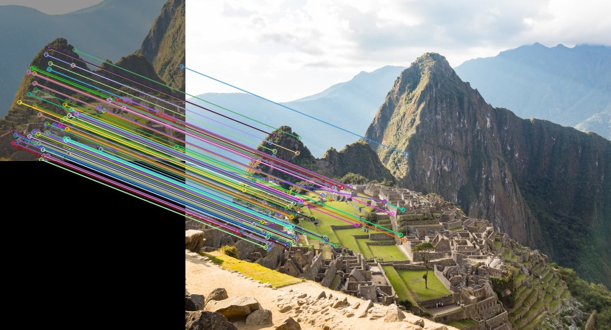

Mosaico no início da otimização, com a imagem _query_ a meio da imagem _train_:

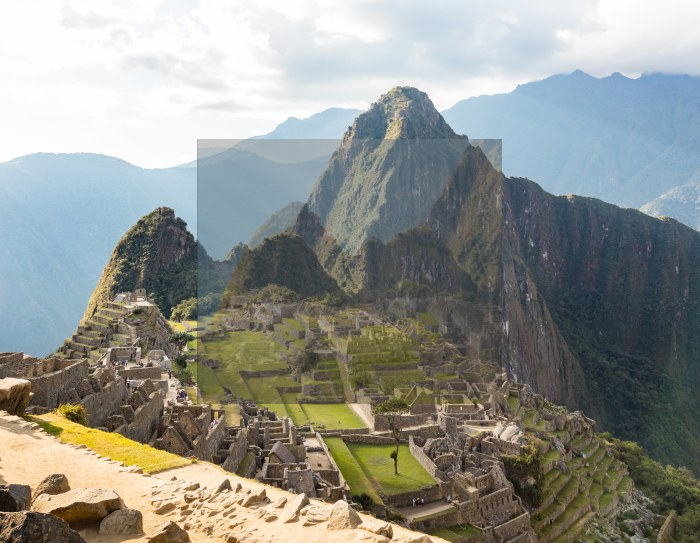

Mosaico no fim da otimização. A geometria está certa, mas a côr da imagem _query_ continua diferente:

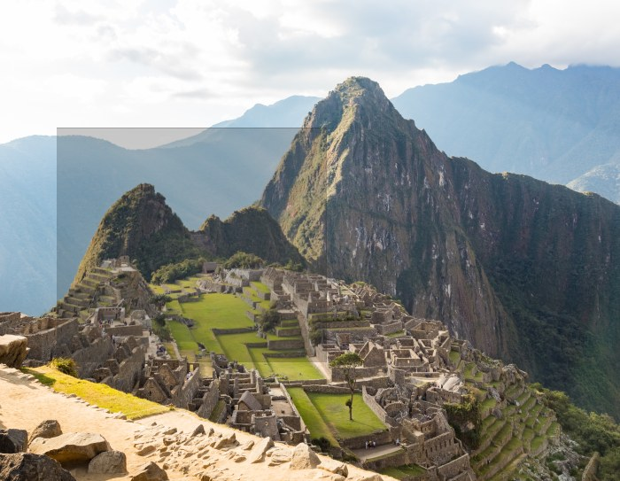

## Exercício 5 - Pares de pontos mal associados

Algumas associações do exercício 4 podem estar erradas. Observe a imagem das associações: há alguma linha que não seja paralela às outras?

1. Calcule a translação com o `cv2.findHomography` (com RANSAC) e compare-a com o resultado do exercício 4.
2. Com a translação obtida, calcule o erro de cada par de pontos e mostre os pares com um erro grande.
3. Repita a otimização do exercício 4 com `loss='soft_l1'`, que reduz o peso dos pares com erros grandes. Compare de novo.

Par de pontos mal associado:

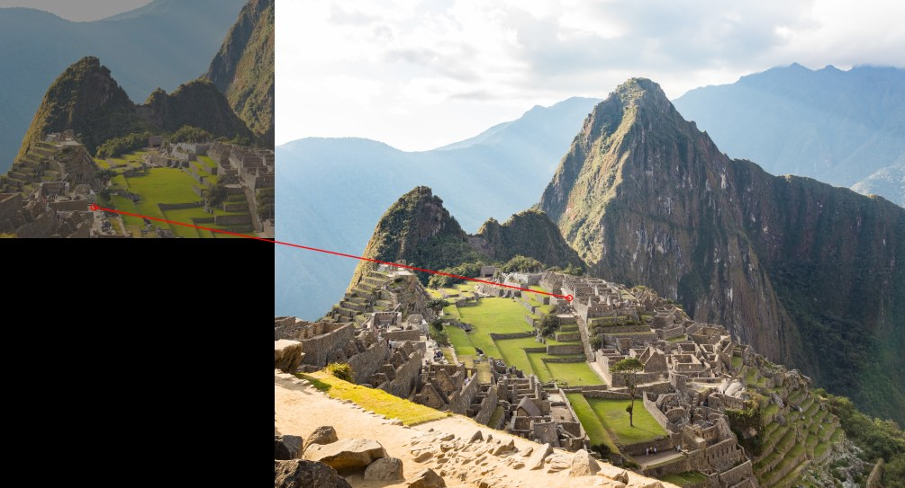

## Exercício 6 - Alinhamento geométrico e fotométrico em simultâneo

Junte os exercícios 2 e 4 numa única otimização, com os parâmetros $\Delta x$, $\Delta y$, $s$ e $b$.

Desta vez não use _features_. O erro é calculado diretamente com os pixeis: para cada pixel da imagem _query_,

$e(x,y) = s \cdot I_q(x,y) + b - I_t(x + \Delta x, y + \Delta y)$

A imagem _train_ é a referência, por isso só a imagem _query_ é corrigida.

Sugestões:

- Reduza o tamanho das imagens (por exemplo para 1/8) e aplique um _blur_ antes de otimizar.
- Para deslocamentos que não são números inteiros use o `cv2.remap`.
- Comece com $\Delta x$ e $\Delta y$ a meio dos valores possíveis, $s = 1$ e $b = 0$. O que acontece? Porquê?
- Use o _template matching_ (Parte 02) para obter uma estimativa inicial de $\Delta x$ e $\Delta y$, e depois refine-a com a otimização.

Resultado a partir do meio da imagem. A otimização fica presa numa posição errada:

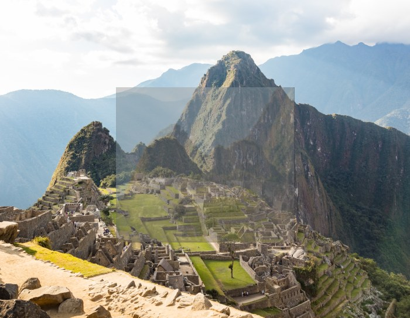

Resultado a partir da estimativa do _template matching_. A geometria e a côr ficam ambas alinhadas:

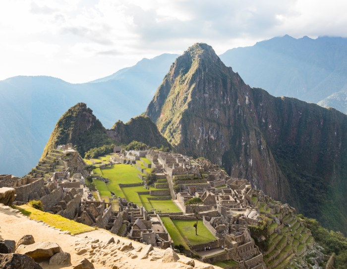

Compare os valores obtidos com os dos exercícios 2 e 4.
