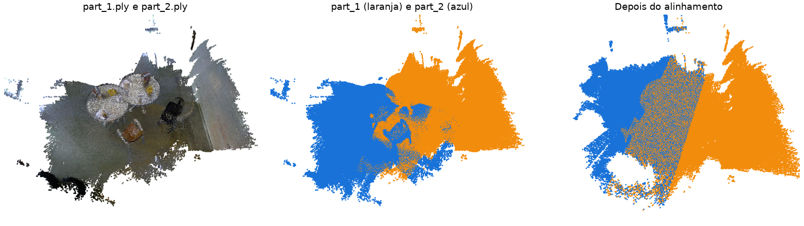

Parte 08 - SAVI
==============
Miguel Riem Oliveira <mriem@ua.pt>
2026-2027

# Sumário

Iterative Closest Point

# Exercícios

Na pasta **icp_point_clouds** encontra duas nuvens de pontos, `part_1.ply` e `part_2.ply`. São duas partes de uma mesma cena real, uma sala com uma mesa e algumas cadeiras, do _dataset_ [UW RGB-D Scenes v2](https://rgbd-dataset.cs.washington.edu/dataset/rgbd-scenes-v2/). As duas partes têm uma zona em comum, mas a segunda foi deslocada: está rodada e transladada em relação à primeira.

O ficheiro `T_true.json` contém a transformação verdadeira, `T_part_1_part_2`, que leva os pontos de `part_2` para o referencial de `part_1`. Em todos os exercícios, compare a transformação que obtém, $T$, com a verdadeira: com $E = T_{true}^{-1} \, T$, o erro de translação é a norma da translação de $E$, em milímetros, e o erro de rotação é o ângulo da rotação de $E$, em graus.

Qualquer rotação 3D equivale a rodar um ângulo $\theta$ em torno de um eixo, e $\theta$ obtém-se da matriz de rotação $R_E$ (as 3 primeiras linhas e colunas de $E$):

$$\theta = \arccos\left(\frac{r_{11} + r_{22} + r_{33} - 1}{2}\right)$$

onde $r_{11}$, $r_{22}$ e $r_{33}$ são os elementos da diagonal de $R_E$. A esta soma chama-se o traço da matriz, $\mathrm{tr}(R_E)$, e em Python calcula-se com `np.trace(R_E)`. Se a estimativa for perfeita, $R_E$ é a identidade, a soma dá 3 e $\theta = 0°$. Use `np.clip(..., -1, 1)` antes do `arccos`, porque erros numéricos podem dar valores ligeiramente acima de 1. Para confirmar o resultado, pode usar `np.degrees(scipy.spatial.transform.Rotation.from_matrix(R_E).magnitude())`, que deve dar o mesmo ângulo.

## Exercício 1 - registo no CloudCompare

Abra `part_1.ply` e `part_2.ply` no **CloudCompare** e alinhe `part_2` com `part_1`:

1. Faça um alinhamento grosseiro com a ferramenta **Tools > Registration > Align (point pairs picking)**, escolhendo pelo menos três pares de pontos correspondentes nas duas nuvens;
2. Refine o alinhamento com **Tools > Registration > Fine registration (ICP)**;
3. Registe a matriz de transformação final, que o CloudCompare mostra na consola, e calcule o seu erro em relação a `T_true.json`.

## Exercício 2 - ICP no Open3D, com uma estimativa inicial

Siga o [tutorial de iterative closest point do Open3D](https://www.open3d.org/docs/latest/tutorial/pipelines/icp_registration.html) e alinhe `part_2.ply` com `part_1.ply`:

1. Carregue as duas nuvens e mostre-as juntas, cada uma pintada de uma cor, como na função `draw_registration_result` do tutorial;
2. Corra o ICP ponto a ponto (_point-to-point_) e o ICP ponto a plano (_point-to-plane_) a partir da identidade, com vários valores do limiar de distância (`threshold`), por exemplo 0.02, 0.05 e 0.2 m. Não se esqueça de estimar as normais. O que acontece?
3. Construa à mão uma estimativa inicial: uma matriz 4x4 que aproxime a rotação e a translação entre as duas partes, a partir do que vê na visualização ou do alinhamento grosseiro do Exercício 1. Volte a correr os dois ICP a partir dela. Depois, corra de novo o ICP a partir do resultado obtido, com um limiar menor (0.02 m). O erro diminui? Porquê?
4. Para cada caso, calcule o erro em relação a `T_true.json` e compare-o com os valores de `fitness` e `inlier_rmse` que o ICP devolve. Bastam estes valores para saber se o alinhamento ficou correto?

Porque é que o resultado depende tanto do limiar e da estimativa inicial? Que diferença faz usar o ICP ponto a plano?

## Exercício 3 - registo global e ICP

No Exercício 2, a estimativa inicial foi feita à mão. Siga o [tutorial de registo global do Open3D](https://www.open3d.org/docs/latest/tutorial/pipelines/global_registration.html) para a obter de forma automática:

1. Reduza as duas nuvens (_downsampling_), estime as normais e calcule as _features_ FPFH de cada ponto;
2. Estime uma transformação inicial com RANSAC, a partir das associações entre _features_;
3. Refine-a com o ICP do Exercício 2;
4. Calcule o erro da transformação depois do RANSAC e depois do ICP, e compare com os Exercícios 1 e 2.

**Nota:** a estimativa inicial também pode vir das imagens, em vez das _features_ 3D. Com duas imagens RGB-D, associe _keypoints_ das imagens a cores (por exemplo SIFT, Parte 04), obtenha o ponto 3D de cada _keypoint_ a partir da profundidade, e estime a transformação com RANSAC a partir destes pares de pontos 3D. Esta é uma das abordagens possíveis para o registo do Trabalho 1.

## Exercício 4 - segmentação dos objetos sobre a mesa

Na pasta **scene_point_cloud** encontra a nuvem de pontos agregada da cena, `scene.ply`: as duas partes juntas numa só nuvem, com `part_2` levada para o referencial de `part_1` pela transformação de `T_true.json`, e reduzida com um _voxel_ de 1 cm. É o resultado de um registo perfeito nos exercícios anteriores. Pretende-se isolar os objetos que estão sobre a mesa, como na Parte 2 do Trabalho 1:

1. Detete o plano do chão com RANSAC (`segment_plane`, Parte 07): é o maior plano da cena. Calcule a altura de cada ponto em relação ao chão, a partir da equação do plano, e escolha o sentido da normal de forma a que a altura seja positiva acima do chão;
2. Detete o plano da mesa, aplicando o RANSAC apenas aos pontos com altura entre 0.5 e 1.0 m. Podem aparecer, no mesmo plano, pontos de outras superfícies à mesma altura: separe os pontos do plano com _clustering_ euclidiano e fique com o maior grupo, que é o tampo da mesa;
3. Defina o referencial da mesa: origem no centro do tampo, eixo z perpendicular à mesa e a apontar para cima, eixos x e y no plano da mesa. Escreva-o como uma matriz 4x4, `T_scene_table`, e transforme a nuvem para este referencial. A coordenada z de cada ponto passa a ser a sua altura acima da mesa;
4. Mantenha só os pontos entre 1 cm e 40 cm acima da mesa e dentro dos limites do tampo, isto é, com as coordenadas x e y entre os valores mínimos e máximos das coordenadas x e y dos pontos do tampo. Porque é que não basta a altura?
5. Separe os objetos com _clustering_ euclidiano (`cluster_dbscan`), descarte os _clusters_ pequenos e pinte cada objeto de uma cor diferente. Mostre os objetos sobre o tampo da mesa, este a cinzento;
6. Grave a nuvem de pontos de cada objeto, no referencial da mesa, num ficheiro separado (`object_0.ply`, `object_1.ply`, ...), para o Exercício 5.

Quantos objetos encontra? O que acontece se aplicar o RANSAC à nuvem completa, sem procurar primeiro o chão: o plano encontrado é o da mesa? E se não restringir os pontos ao interior do tampo? Como escolheu o limiar de distância do RANSAC e o `eps` do `cluster_dbscan`?

## Exercício 5 - _bounding boxes_ dos objetos

Há dois tipos de caixa envolvente (_bounding box_). A caixa alinhada com os eixos (_axis aligned bounding box_, AABB) tem as arestas paralelas aos eixos do referencial. A caixa orientada (_oriented bounding box_, OBB) tem a sua própria orientação, estimada a partir dos pontos. Pretende-se perceber a diferença entre as duas.

Carregue as nuvens de pontos dos objetos gravadas no Exercício 4, no referencial da mesa. Para cada objeto:

1. Calcule a AABB, com `get_axis_aligned_bounding_box()`, e a OBB, com `get_oriented_bounding_box()`;
2. Mostre as duas caixas sobre a nuvem de pontos do objeto, cada uma com a sua cor, e escreva as suas dimensões e volumes (`volume()`);
3. Rode cada objeto 30° em torno do eixo z, em torno do seu centro (`get_rotation_matrix_from_xyz` e `rotate`), e volte a calcular e a mostrar as duas caixas.

Que caixa muda quando o objeto roda, e porquê? A AABB depende de quê, além dos pontos do objeto? A OBB tem sempre um volume menor do que a AABB? O eixo z da OBB fica perpendicular à mesa? Para o objeto que parece uma caixa de cereais, qual das duas descreve melhor o objeto?
