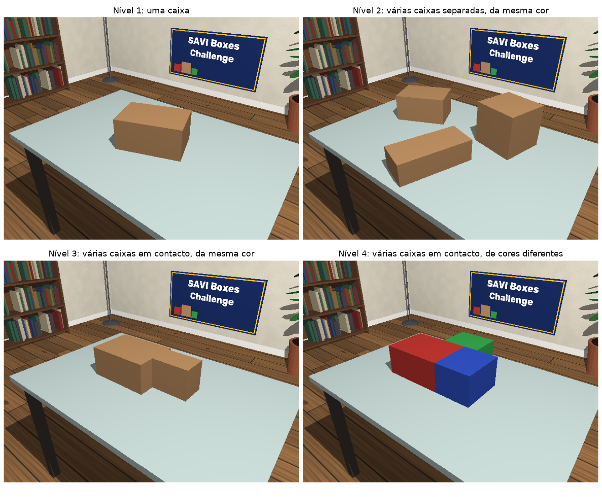
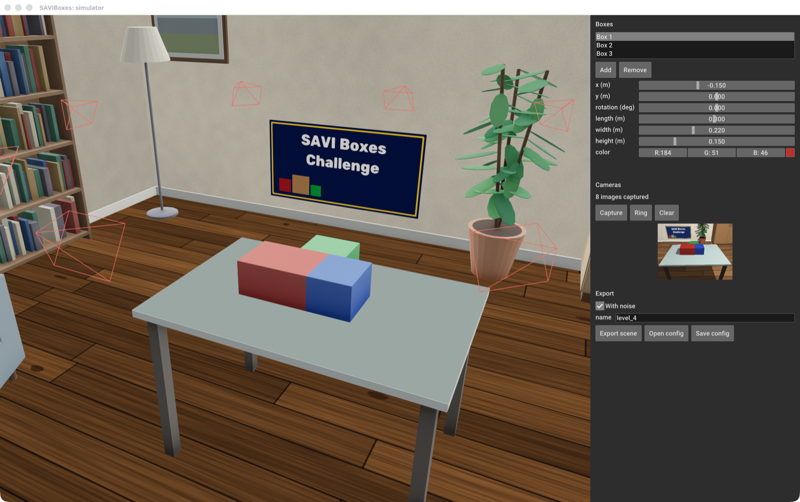
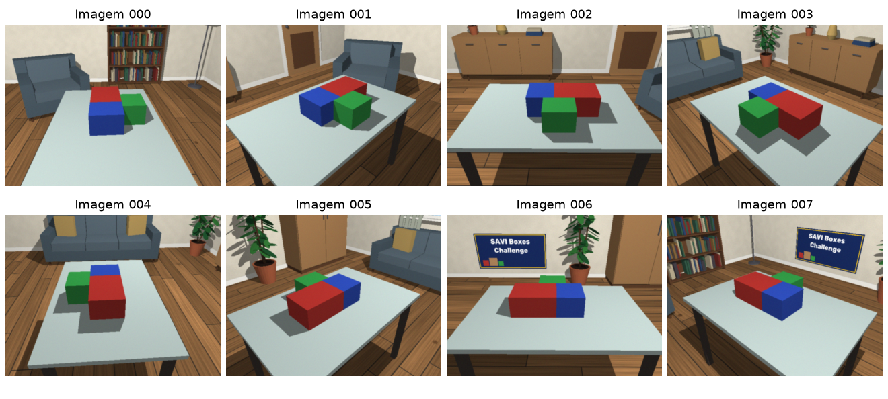
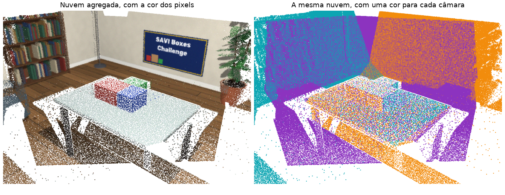
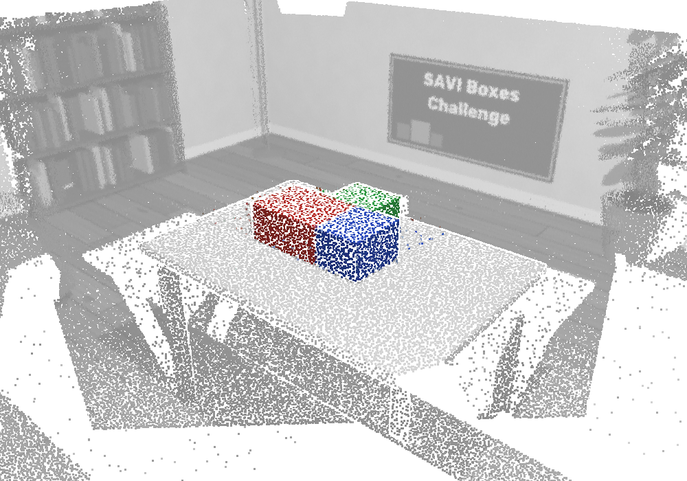
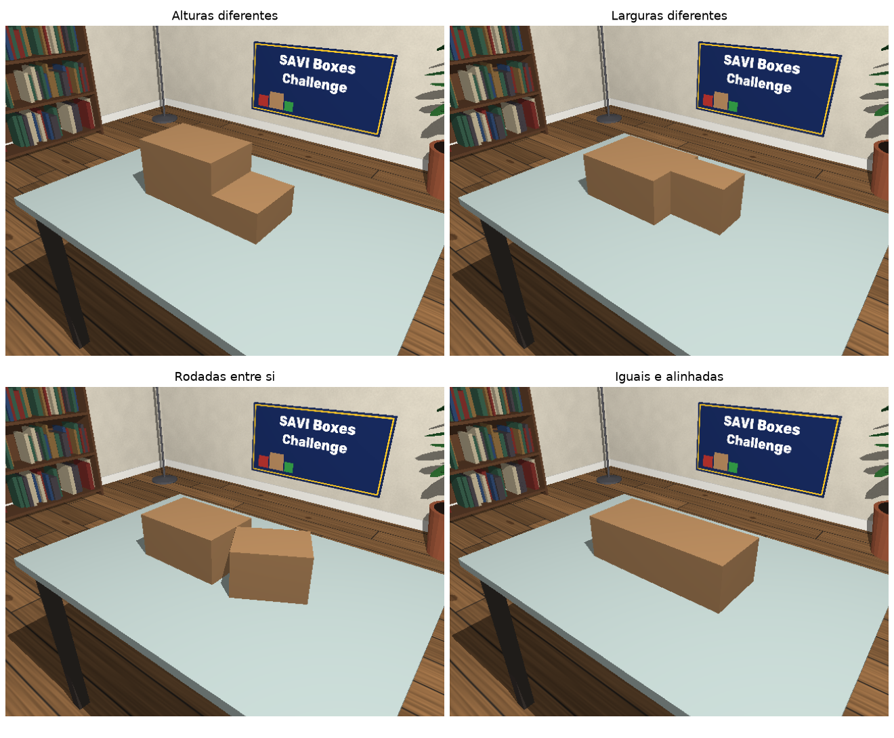

Trabalho prático 1 - SAVI
==============
Miguel Riem Oliveira <mriem@ua.pt>
2026-2027

# Trabalho Prático: SAVIBoxes

**Estimação da pose e das dimensões de caixas sobre uma mesa, a partir de várias imagens RGB-D**

## Informações gerais

- O trabalho é feito por grupos de um ou dois alunos;
- Cada grupo cria um repositório no GitHub chamado `savi-2026-2027-trabalho1-grupoX`, em que X é o número do grupo. Todo o trabalho é desenvolvido e entregue nesse repositório;
- O repositório pode ser público ou privado. Se for privado, convide o professor (`miguelriemoliveira`) como colaborador;
- O que o repositório deve conter no final está descrito em "Entrega".

## Introdução

Há caixas sobre uma mesa, algumas delas empilhadas sobre outras. Uma câmara RGB-D adquire várias imagens em redor da mesa. O objetivo é estimar, para cada caixa, a sua pose e as suas dimensões, com um erro da ordem dos milímetros.

Com uma caixa isolada, o problema parece simples. Fica difícil quando as caixas se tocam, porque deixa de ser claro onde acaba uma e começa a outra.



O trabalho junta o que foi dado até agora:

- **Processamento de imagem e fotométrico:** _features_ para iniciar o registo (Parte 04) e informação de cor (Partes 02 e 06);
- **Processamento 3D:** nuvens de pontos, RANSAC, _clustering_ e ICP (Partes 07 e 08);
- **Otimização:** ajuste de um modelo aos dados com `scipy.optimize.least_squares` (Partes 05 e 06). **O ajuste geométrico é o ponto central do trabalho.**

O sistema é desenvolvido e avaliado com dados do simulador que é fornecido, porque só assim se conhece o valor exato de cada pose e de cada dimensão.

## O simulador

É fornecido o simulador **SAVI Box Simulator**. Com ele configura-se uma cena: a mesa, as caixas sobre ela ou empilhadas, com as suas posições, dimensões e cores, e a sala em redor. Depois coloca-se o sensor numa posição, a olhar numa direção, e o simulador calcula, por _ray casting_, o que uma câmara RGB-D veria dali: a imagem a cores e a nuvem de pontos, com ruído semelhante ao de um sensor real.

É por isso que se usa um simulador: produz dados de sensor simulados, com os quais se testam os algoritmos. A grande vantagem é que, juntamente com esses dados, se tem o _ground truth_ completo da cena que os gerou: a pose de cada câmara, a pose e as dimensões de cada caixa. Com dados reais, estes valores nunca se conhecem com exatidão. Com o simulador, o erro de cada estimativa do seu sistema pode ser medido. Não tem de programar o simulador: use-o para criar as cenas com que desenvolve e avalia o seu sistema.

O código está na pasta [`simulator`](simulator), junto a este enunciado. Para o abrir:

```
cd Trabalho1/simulator
pip install -r requirements.txt
./savi_box_simulator.py
```

Os comandos seguintes são todos corridos dentro da pasta `simulator`.

### Criar cenas na interface gráfica



1. Em **Boxes**, adicione e remova caixas, e altere a posição, a rotação, as dimensões e a cor de cada uma. O valor **z** é a altura da base da caixa acima do tampo da mesa: com z = 0 a caixa assenta na mesa, e para a empilhar sobre outra dá-se a z a altura do topo da caixa de baixo. O botão **Stack** faz isto automaticamente: pousa a caixa selecionada sobre a caixa mais alta que está por baixo do seu centro (só contam as caixas anteriores na lista), ou na mesa se não houver nenhuma;
2. Navegue na vista 3D com o rato e carregue em **Capture** para adquirir uma imagem a partir desse ponto de vista. O botão **Ring** acrescenta um conjunto de câmaras em redor da mesa. As imagens adquiridas aparecem numa lista, e cada câmara aparece na vista 3D com o número da sua imagem. Ao clicar numa imagem da lista, a vista 3D passa para o ponto de vista dessa câmara. Com a opção **Show point cloud of the selected image**, a vista 3D mostra a nuvem de pontos dessa imagem, no lugar da sala, da mesa e das caixas;
3. Escolha o nome da cena e carregue em **Export scene**. A cena fica na pasta `scenes`. A opção **With noise** acrescenta o ruído do sensor e a opção **Exposure changes** faz variar o brilho e o contraste de imagem para imagem (ver "Extras");
4. Com **Save config** e **Open config** pode gravar e abrir a configuração da cena.

Para começar a partir de um dos exemplos fornecidos:

```
./savi_box_simulator.py --config configs/level_4.json
```

### Criar cenas sem interface

Para gerar muitas cenas, por exemplo para estudar o efeito do ruído, use ficheiros de configuração:

```
./savi_box_simulator.py --batch configs/level_*.json
./savi_box_simulator.py --batch configs/level_1.json --no_noise
./savi_box_simulator.py --batch configs/level_4.json --exposure_changes
```

A pasta `configs` tem um exemplo para cada nível, e o ficheiro `base.json` tem os valores por omissão: câmara, mesa, sala, luz, número e posição das câmaras, e ruído.

### Ruído

O ruído é definido na secção `noise` da configuração:

| Parâmetro | Efeito |
|---|---|
| `depth_std` | Ruído na profundidade, que cresce com o quadrado da distância |
| `flying_pixels` | Probabilidade de um pixel numa aresta ficar com uma profundidade intermédia, entre o objeto e o fundo |
| `edge_dropouts` | Probabilidade de um pixel numa aresta ficar sem medição |
| `color_std` | Ruído de cor |
| `blur_px` | Desfoque da imagem a cores |
| `misalignment_px` | Desalinhamento entre as imagens de cor e de profundidade, que mistura as cores de objetos vizinhos junto às fronteiras entre eles |
| `exposure_changes` | Liga a variação do brilho e do contraste de imagem para imagem, como numa câmara com exposição automática. Por omissão está desligada |
| `gain_std`, `bias_std` | Desvio padrão do ganho $s$ e do desvio $b$ de cada imagem, quando `exposure_changes` está ligada |

### Formato das cenas

Todas as cenas, simuladas ou reais, usam o mesmo formato. O seu programa tem de funcionar com qualquer cena neste formato.

```
scene/
    point_clouds/000.ply   # nuvem de pontos com cor, no referencial da câmara que a adquiriu
    rgb/000.png            # imagem a cores correspondente
    ...
    intrinsics.json        # fx, fy, cx, cy, width, height
    ground_truth.json      # só para avaliação; não existe nas cenas de teste
    config.json            # configuração que gerou a cena
```

- O referencial da câmara tem x para a direita, y para baixo e z para a frente.
- O referencial de cada caixa tem origem no seu centro, o eixo x ao longo do comprimento (`length`), o eixo y ao longo da largura (`width`) e o eixo z ao longo da altura (`height`), perpendicular à mesa e a apontar para cima.
- O ficheiro `ground_truth.json` contém a pose de cada câmara, a pose e as dimensões de cada caixa. Para cada caixa, além das matrizes `T_world_box` e `T_camera0_box`, dá também `x`, `y`, `z` e `yaw_deg` no referencial do mundo, que tem origem no centro do tampo da mesa e z para cima: `x` e `y` são o centro da caixa, `yaw_deg` a rotação em torno de z, em graus, e `z` a altura da base da caixa acima do tampo (0 para uma caixa assente na mesa). O centro da caixa fica, por isso, à altura `z + height / 2`. **O seu sistema só o pode usar, tal como o `config.json`, para calcular erros, nunca para estimar seja o que for.**

Exemplo de oito imagens adquiridas em redor da mesa:



## O programa a desenvolver

O seu programa principal recebe a pasta da cena e o número de caixas, e escreve um ficheiro `result.json`. Por exemplo, para uma cena com duas imagens e três caixas:

```
./main.py --scene scene_folder --num_boxes 3
```

```json
{
  "cameras": [
    {
      "image": "000",
      "T_camera0_camera": [
        [1.000, 0.000, 0.000, 0.000],
        [0.000, 1.000, 0.000, 0.000],
        [0.000, 0.000, 1.000, 0.000],
        [0.000, 0.000, 0.000, 1.000]
      ]
    },
    {
      "image": "001",
      "T_camera0_camera": [
        [ 0.385, 0.418, -0.823,  0.998],
        [-0.418, 0.874,  0.249, -0.302],
        [ 0.823, 0.249,  0.511,  0.593],
        [ 0.000, 0.000,  0.000,  1.000]
      ]
    }
  ],
  "boxes": [
    {
      "T_camera0_box": [
        [ 0.806,  0.592,  0.000, -0.042],
        [ 0.268, -0.365, -0.891, -0.091],
        [-0.528,  0.718, -0.453,  1.338],
        [ 0.000,  0.000,  0.000,  1.000]
      ],
      "length": 0.30,
      "width": 0.20,
      "height": 0.15
    },
    {
      "T_camera0_box": [
        [-0.023,  1.000,  0.000, 0.133],
        [ 0.453,  0.010, -0.891, 0.025],
        [-0.891, -0.020, -0.453, 1.164],
        [ 0.000,  0.000,  0.000, 1.000]
      ],
      "length": 0.22,
      "width": 0.18,
      "height": 0.10
    },
    {
      "T_camera0_box": [
        [ 0.998, -0.064,  0.000, -0.150],
        [-0.029, -0.452, -0.891,  0.054],
        [ 0.057,  0.890, -0.453,  1.129],
        [ 0.000,  0.000,  0.000,  1.000]
      ],
      "length": 0.25,
      "width": 0.12,
      "height": 0.08
    }
  ]
}
```

**Referenciais e transformações:**

- Todas as poses são dadas no referencial da câmara da imagem 000, a que se chama `camera0`. As dimensões estão em metros;
- `T_A_B` é a matriz 4x4 que transforma as coordenadas de um ponto do referencial B para o referencial A, em coordenadas homogéneas: $p_A = T_{A,B} \, p_B$. As três primeiras colunas são os eixos x, y e z do referencial B escritos no referencial A, e a última coluna é a origem de B escrita em A;
- `T_camera0_camera` é a pose de cada câmara em relação à câmara 000. Para a própria câmara 000 é a identidade;
- `T_camera0_box` é a pose de cada caixa em relação à câmara 000. O referencial da caixa é o definido em "Formato das cenas": origem no centro da caixa, x ao longo de `length`, y ao longo de `width` e z ao longo de `height`, a apontar para cima;
- **Atenção às simetrias.** A altura não tem ambiguidade, porque o eixo z aponta sempre para cima. Já o comprimento e a largura podem vir trocados: o seu sistema pode chamar `length` ao lado que o `ground_truth.json` chama `width`, com o referencial rodado 90° em torno de z, e trata-se da mesma caixa. Do mesmo modo, rodar o referencial 180° em torno de z não muda a caixa. Todas estas poses são aceites, desde que o eixo z aponte para cima;
- Por isso, ao calcular os erros, compare cada estimativa com todas as versões equivalentes da caixa verdadeira e fique com a de menor erro. Antes disso, associe cada caixa estimada a uma caixa do `ground_truth.json`, porque a ordem das listas não tem de ser a mesma.

## Parte 1: Registo

Construa uma nuvem de pontos agregada a partir de todas as nuvens da cena.

1. **Pré-processamento:** filtre os pontos, faça _downsampling_ e estime as normais;
2. **Estimativa inicial:** associe _features_ das imagens (Parte 04) e use as nuvens para obter pares de pontos 3D, ou use _features_ 3D. Estime com estes pares uma transformação inicial, de forma robusta a associações erradas;
3. **ICP:** refine as transformações. Pode usar `open3d.pipelines.registration.registration_icp`. **O ICP deve usar a nuvem de pontos completa, incluindo a mesa e o fundo;**
4. **Agregação:** aplique as transformações às nuvens de pontos com a resolução original.

Nuvens de pontos de três câmaras vizinhas, juntas numa nuvem agregada. À esquerda, cada ponto tem a cor do seu pixel; à direita, cada ponto tem a cor da câmara que o adquiriu:



**Comparação com o _ground truth_:** compare cada transformação estimada `T_camera0_camera` com a do `ground_truth.json`. Apresente, para cada câmara, o erro de translação, em milímetros, e o erro de rotação, em graus, dado pelo ângulo da rotação $R_{est}^T R_{gt}$. Mostre também a sua nuvem agregada sobreposta à nuvem agregada obtida com as transformações verdadeiras.

**A analisar:**

- O que acontece ao ICP se retirar o fundo e deixar apenas a mesa e as caixas? Porquê?
- O que acontece ao erro quando encadeia muitas imagens? A última imagem alinha com a primeira?
- Que efeito têm os erros de registo na nuvem de pontos agregada?

## Parte 2: Segmentação

A segmentação é feita sobre a **nuvem de pontos agregada**.

1. Detete o plano da mesa com RANSAC e defina a partir dele um referencial da mesa;
2. Retire a mesa e o fundo, mantendo os pontos acima da mesa e dentro dos seus limites;
3. Separe os objetos com _clustering_ euclidiano;
4. Use a cor dos pontos quando for útil (Nível 4).

Resultado esperado: os pontos dos objetos sobre a mesa ficam isolados do resto da nuvem agregada, aqui a cinzento:



**Comparação com o _ground truth_:** o `ground_truth.json` não diz a que objeto pertence cada ponto, mas dá a pose e as dimensões de cada caixa. Para avaliar só a segmentação, sem os erros do registo, junte as nuvens com as transformações verdadeiras e marque como pontos de cada caixa os que ficam dentro dela, com uma pequena margem por causa do ruído (por exemplo, 5 mm). Compare depois com os conjuntos de pontos da sua segmentação:

- Quantas caixas encontrou, em relação ao número real;
- Precisão: que fração dos pontos de cada conjunto pertence de facto à caixa correspondente;
- _Recall_: que fração dos pontos de cada caixa ficou no conjunto certo.

## Parte 3: Ajuste das caixas

Esta é a parte central do trabalho. Implemente **dois métodos** e compare-os em todos os níveis.

### Método base: _bounding box_

Este método serve apenas de referência para comparação. O objetivo do trabalho é o ajuste por otimização, descrito a seguir; a _bounding box_ mostra até onde se chega sem ele.

Depois da segmentação, calcule a _bounding box_ orientada de cada conjunto de pontos com o Open3D: `get_oriented_bounding_box()`, que estima a orientação por PCA do invólucro convexo e dá uma aproximação, ou `get_minimal_oriented_bounding_box()`, que procura a caixa de menor volume. Ambas devolvem um `open3d.geometry.OrientedBoundingBox`, com `center`, `R` e `extent`.

Os eixos desta caixa não seguem a convenção deste trabalho: o eixo z não tem de ser perpendicular à mesa. Converta o resultado para o referencial da caixa definido em "Formato das cenas".

Trate o método de forma justa: remova _outliers_ e tente reduzir a sua sensibilidade aos pontos extremos.

### Método principal: ajuste por otimização

Implemente um procedimento de otimização que ajusta as caixas sobre a mesa à nuvem de pontos, estimando ao mesmo tempo a posição, a orientação e as dimensões de cada caixa.

1. **Parâmetros:** como as caixas ficam sempre com o eixo z perpendicular à mesa, cada caixa fica definida no referencial da mesa por `x`, `y`, `z`, `yaw`, `length`, `width` e `height`, em que `z` é a altura da base da caixa acima da mesa: 0 para uma caixa assente na mesa, o topo da caixa de baixo para uma caixa empilhada;
2. **Função objetivo:** devolve um erro por cada ponto, a distância do ponto à superfície da caixa. Com várias caixas, cada ponto é associado à caixa que melhor o explica;
3. **Otimização:** use `scipy.optimize.least_squares`. **As associações são recalculadas em cada avaliação da função objetivo**, dentro da própria otimização, sem um ciclo exterior. Não há nenhuma garantia de que uma associação feita no início esteja correta;
4. **Estimativa inicial:** é da sua responsabilidade (lembre-se da Parte 06, Exercício 6);
5. **Pontos errados:** o resultado não pode depender de uns poucos pontos errados (lembre-se da Parte 06, Exercício 5);
6. **Visualização:** mostre a evolução das caixas ao longo da otimização, sobre a nuvem de pontos.

**Comparação com o _ground truth_:** para cada caixa, compare o resultado dos dois métodos com o `ground_truth.json`:

- Erro de posição: distância entre o centro estimado e o centro verdadeiro, em milímetros;
- Erro de altura: diferença entre o `z` estimado e o verdadeiro, em milímetros;
- Erro de orientação: diferença entre o _yaw_ estimado e o verdadeiro, em graus;
- Erro das dimensões: diferença de `length`, `width` e `height`, em milímetros;
- IoU 3D (_Intersection over Union_): o volume da interseção entre a caixa estimada e a caixa verdadeira, a dividir pelo volume da sua união. Vale 1 quando as caixas coincidem e 0 quando não se sobrepõem, e resume num só número os erros de posição, de orientação e de dimensões. Como as caixas têm sempre o eixo z vertical, o volume da interseção é a área da interseção dos dois retângulos vistos de cima (pode usar `cv2.rotatedRectangleIntersection`, que devolve o polígono da interseção, e `cv2.contourArea`, que dá a sua área) multiplicada pela sobreposição dos intervalos de altura das duas caixas, de `z` a `z + height`.

Nos erros de orientação e de dimensões, tenha em conta as simetrias da caixa (ver "O programa a desenvolver"): compare com todas as versões equivalentes da caixa verdadeira e fique com a de menor erro. O IoU 3D não precisa deste cuidado, porque só depende do espaço ocupado pela caixa. Por isso, também é uma boa forma de associar cada caixa estimada à caixa verdadeira correspondente. Mostre ainda as caixas estimadas sobrepostas às caixas verdadeiras.

**A analisar, também na defesa:**

- Uma caixa pode crescer sem que o erro aumente? Em que situações, e porquê? O que fez para o resolver?
- Duas caixas podem ocupar o mesmo espaço? O que acontece na otimização se isso for permitido?
- Porque é que este ajuste dispensa um ciclo exterior que alterne entre associar os pontos às caixas e otimizar?
- Que pontos determinam cada parâmetro? Um ponto no meio do topo da caixa ajuda a estimar o seu comprimento?
- Porque é que a _bounding box_ é tão sensível ao ruído? Que pontos usa, afinal?

## Níveis de dificuldade

Em todos os níveis o número de caixas é conhecido. Para cada nível, crie várias cenas no simulador e apresente uma tabela com os erros dos dois métodos, definidos na Parte 3.

### Nível 1: uma caixa

Uma única caixa sobre a mesa. A _bounding box_ resolve o problema. O ajuste por otimização traz alguma vantagem? A partir de que nível de ruído?

### Nível 2: várias caixas separadas, da mesma cor

De 2 a 4 caixas sem contacto entre si. Basta separá-las por _clustering_ euclidiano antes de aplicar qualquer um dos métodos.

### Nível 3: várias caixas em contacto, da mesma cor

De 2 a 4 caixas que se tocam e formam um único _cluster_. O _clustering_ euclidiano e a cor deixam de as conseguir separar.

Experimente pelo menos estes casos: caixas de alturas diferentes, caixas da mesma altura e larguras diferentes, caixas rodadas entre si, caixas iguais e perfeitamente alinhadas, caixas empilhadas umas sobre as outras.



**Alguns destes casos são impossíveis de resolver, por falta de informação.** Identifique quais, demonstre o problema e explique porquê. Não se trata de os resolver.

### Nível 4: várias caixas em contacto, de cores diferentes

A cor traz a informação que faltava. Use-a na segmentação, na otimização, ou em ambas, e compare as abordagens:

- Separar os pontos por cor e depois aplicar a _bounding box_ a cada conjunto;
- Separar os pontos por cor e depois ajustar cada caixa;
- Acrescentar a cor à função objetivo, para que um ponto escolha a caixa que melhor explica a sua posição e a sua cor.

Qual é a mais robusta quando alguns pontos têm a cor errada? Como deve pesar os erros geométricos e os erros de cor (Parte 06, Exercício 3)?

## Extras

Valorizam o trabalho, até ao limite indicado na avaliação:

- **Correção fotométrica:** gere as cenas com a opção **Exposure changes** ligada no simulador (ou `--exposure_changes` em `--batch`). Cada imagem passa a ter o seu ganho $s$ e o seu desvio $b$, como numa câmara com exposição automática, e a mesma superfície aparece mais clara numas imagens e mais escura noutras. Estime $s$ e $b$ de cada imagem em relação à imagem 000 (Parte 06), a partir dos pontos vistos por mais do que uma câmara, corrija as imagens a cores e volte a colorir as nuvens. Compare os valores estimados com os do campo `photometry` do `ground_truth.json` e avalie o efeito na segmentação por cor do Nível 4. Se o seu sistema funcionar com esta opção ligada, o trabalho tem uma valorização extra. Pode depois aplicar a mesma correção aos dados reais;
- **Dados reais:** adquira pelo menos uma cena real com uma das câmaras RGB-D disponíveis, converta-a para o formato das cenas (Parte 08), meça as caixas com uma craveira e corra o sistema completo. A vantagem observada no simulador mantém-se? Porquê?
- **Otimização conjunta:** refine ao mesmo tempo as poses das câmaras e os parâmetros das caixas;
- **Cores semelhantes:** Nível 4 com caixas de cores próximas;
- **Número de caixas desconhecido:** estime também o número de caixas;
- **Novo efeito no simulador:** acrescente ao simulador um efeito observado nos dados reais e mostre o seu impacto nos resultados.

## Dia da apresentação

O objetivo do dia da apresentação é perceber como foi usada a IA. O seu uso é recomendado, mas há duas formas muito diferentes de o fazer: pedir à IA que faça o trabalho e entregar o resultado sem perceber o que se passa, ou trabalhar com a IA em colaboração, discutindo as opções, testando e percebendo cada passo. Só no segundo caso o grupo consegue responder quando lhe é colocado um problema novo: cenas que nunca viu, perguntas sobre o código e alterações pedidas no momento. É isso que se avalia neste dia.

1. No início da sessão, todos os grupos recebem ao mesmo tempo cenas novas, geradas pelo simulador, de todos os níveis, sem `ground_truth.json` nem `config.json`;
2. Cada grupo tem 20 minutos para correr o seu programa nessas cenas e fazer _commit_ e _push_, para o repositório do grupo, do código e dos ficheiros `result.json`;
3. Ao fim dos 20 minutos, todos os grupos param ao mesmo tempo. O professor regista o último _commit_ de cada repositório nesse momento. O que for enviado depois não conta;
4. Antes de apresentar, o grupo volta a esse _commit_ (`git checkout <commit>`) e apresenta a partir dele. O código e os resultados são os que existiam no fim dos 20 minutos, qualquer que seja a ordem de apresentação;
5. O desempenho é medido com o IoU 3D (Parte 3) entre cada caixa estimada e a caixa verdadeira correspondente. Uma caixa que não foi encontrada, ou uma cena em que o programa falhou, conta com IoU igual a 0. A componente "Desempenho nas cenas do dia da apresentação" da avaliação é calculada a partir do IoU 3D médio de todas as caixas de todas as cenas;
6. Segue-se a defesa oral, com alterações ao código feitas no momento.

## Avaliação

| Componente | Peso |
|---|---|
| Parte 1: registo | 10% |
| Parte 2: segmentação | 10% |
| Parte 3: ajuste, comparação com a _bounding box_ e análise | 20% |
| Níveis de dificuldade: níveis resolvidos, com mais peso para os mais difíceis | 10% |
| Desempenho nas cenas do dia da apresentação | 15% |
| Defesa oral | 15% |
| Repositório GitHub: código e README | 10% |
| Extras | 10% |

## Entrega

O repositório do grupo (ver "Informações gerais") deve conter, no fim:

- O código Python, claro e comentado, que corre com o comando indicado em "O programa a desenvolver";
- Os ficheiros de configuração das cenas usadas;
- Um `README.md` com a abordagem de cada parte, os resultados com imagens e gráficos, as tabelas de erros, a resposta às questões colocadas e as dificuldades encontradas.

**Nota:** recomenda-se o uso de IA para a realização do trabalho.

**Nota:** este enunciado ainda vai ser revisto e pode sofrer pequenas alterações. Consulte sempre a versão online, no repositório da disciplina.

Bom trabalho!
